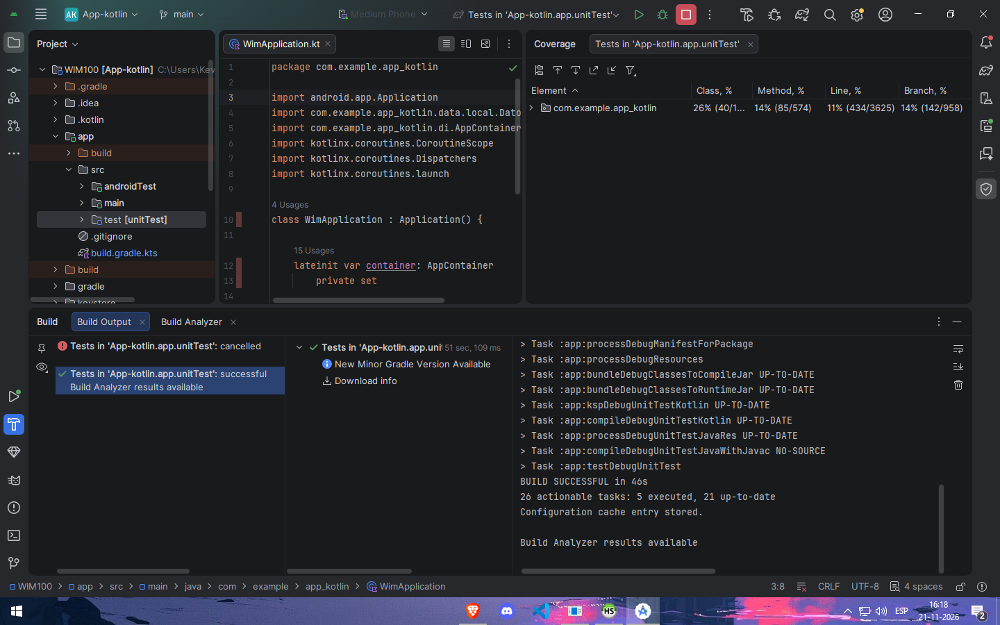
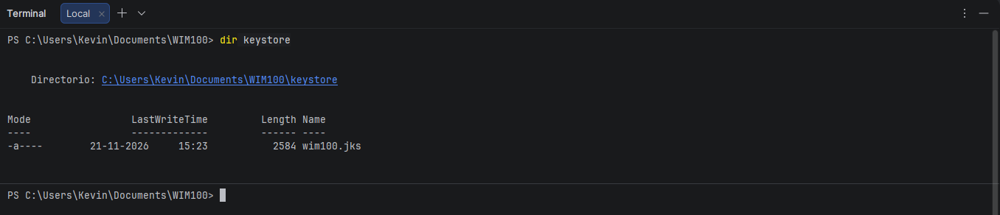
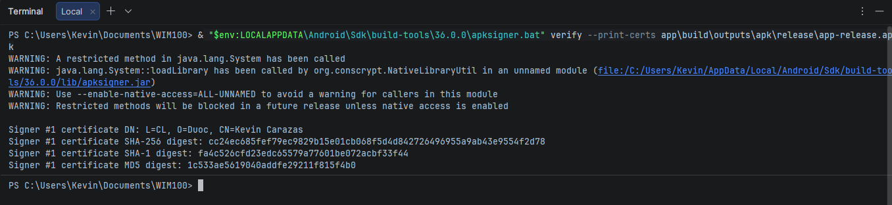

# Programa WIM 100 · App Android

Aplicación móvil para **evaluar candidaturas técnicas** del programa WIM 100 (ciberseguridad). Las evaluadoras registran y puntúan postulantes según una matriz de criterios, y Dirección revisa el ranking y resuelve cada postulación. Los datos de los postulantes viven en un **backend propio (Spring Boot + MySQL)** y la app guarda una copia local con Room.

- **Asignatura:** DSY1105 · DuocUC, Escuela de Informática y Telecomunicaciones
- **Integrantes:** Kevin Carazas · Dario Rojas
- **Repositorio de la app:** https://github.com/eldaridin/WIM100
- **Repositorio del backend:** https://github.com/eldaridin/WIM100_Backend

## Funcionalidades

- **Inicio de sesión contra el backend** (`POST /api/auth/login`). El rol (Evaluadora o Dirección) lo entrega el servidor.
- **Lista de postulantes** con búsqueda por nombre, área o correo, filtro por estado y botón para actualizar desde el servidor.
- **CRUD remoto de postulantes:** registrar, ver detalle, editar y eliminar, con validaciones en el formulario.
- **API externa (randomuser.me):** botón para generar un nombre ficticio al registrar.
- **Evaluación con matriz de criterios** y cálculo de puntaje ponderado (escala 0 a 100) con su categoría.
- **Resultados y ranking** para Dirección, que además cierra la postulación como *Seleccionada* o *No seleccionada*.
- **Historial** de acciones y **perfil** de la sesión.
- **Recursos nativos:** verificación biométrica del dispositivo, notificaciones, selector de PDF para el CV e Intents.
- **Funciona con copia local (Room):** si el backend se apaga, se sigue mostrando la última lista descargada.

## Tecnologías

Kotlin · Jetpack Compose (Material 3) · MVVM · Room + KSP · Retrofit + OkHttp (logging) · Gson · Coroutines y Flow · JUnit 4, MockK y coroutines-test.

`minSdk 24` · `targetSdk 36`

## Arquitectura

```
app/src/main/java/com/example/app_kotlin/
├── data/
│   ├── local/        Room: DAOs y base de datos
│   ├── remote/       Retrofit: WimApi, RandomUserApi, DTOs, mapeos y mensajes de error
│   └── repository/   CandidataRepository, AuthRepository, HistorialRepository, RandomUserRepository
├── model/            Entidades, enums, sesión y CalculadoraPuntaje
├── validation/       Validadores de formularios
├── viewmodel/        ViewModels con StateFlow
├── ui/               Pantallas, componentes y tema (Compose)
├── nativo/           Biometría, notificaciones, archivos, intents y permisos
└── navigation/       Rutas y NavHost
```

El **backend es la fuente oficial** de los postulantes. Room guarda una copia que observan las pantallas y que necesitan las evaluaciones.

## Endpoints

### Microservicio propio (`wim100-backend`, base: `http://localhost:8080/api`)

| Método | Ruta | Descripción | Respuestas |
| --- | --- | --- | --- |
| `GET` | `/postulantes` | Lista todos los postulantes | 200 |
| `GET` | `/postulantes/{id}` | Obtiene un postulante | 200, 404 |
| `POST` | `/postulantes` | Registra un postulante | 201, 400, 409 (correo repetido) |
| `PUT` | `/postulantes/{id}` | Actualiza los datos | 200, 400, 404, 409 |
| `PATCH` | `/postulantes/{id}/estado` | Cambia el estado (`{"estado":"EVALUADA"}`) | 200, 400, 404 |
| `DELETE` | `/postulantes/{id}` | Elimina un postulante | 204, 404 |
| `POST` | `/auth/login` | Inicia sesión (`{"usuario":"...","password":"..."}`) | 200, 401 |

El backend también expone `/api/usuarios` (gestión de usuarios), que la app no usa.

Estados válidos: `POSTULADA`, `EN_EVALUACION`, `EVALUADA`, `SELECCIONADA`, `NO_SELECCIONADA`.

### API externa

| Método | URL | Uso |
| --- | --- | --- |
| `GET` | `https://randomuser.me/api/?gender=female&nat=es&inc=name` | Genera un nombre ficticio (no requiere key) |

## Usuarios de prueba

El backend los crea al arrancar la primera vez.

| Usuario | Contraseña | Rol |
| --- | --- | --- |
| `evaluadora1` | `wim2026` | Evaluadora |
| `evaluadora2` | `wim2026` | Evaluadora |
| `direccion` | `wim2026` | Dirección |

## Cómo ejecutar (backend primero)

### 1. Levantar el backend

Requisitos: Java 21 y MySQL 8 (o Docker). Detalle completo en el README del backend.

```bash
git clone https://github.com/eldaridin/WIM100_Backend.git
cd WIM100_Backend/wim100-backend
docker compose up -d
./mvnw spring-boot:run
```

En Windows, usa `.\mvnw.cmd spring-boot:run`. Si usas tu propio MySQL, revisa usuario y contraseña en `src/main/resources/application.properties` (por defecto `root` / `root`; la base `wim100` se crea sola).

Comprueba que responde:

```bash
curl http://localhost:8080/api/postulantes
```

### 2. Abrir la app en Android Studio

```bash
git clone https://github.com/eldaridin/WIM100.git
```

1. En Android Studio: *File › Open* y elige la carpeta `WIM100`.
2. Espera el *Sync* de Gradle.
3. Crea o elige un emulador (API 24 o superior) y pulsa **Run**.
4. Inicia sesión con `evaluadora1` / `wim2026`.

El emulador accede al `localhost` de tu PC mediante `10.0.2.2`, así que la `BASE_URL` por defecto (`http://10.0.2.2:8080/api/`) ya funciona.

### 3. Teléfono físico

1. Conecta el teléfono a la **misma Wi-Fi** que el PC.
2. Busca la IP del PC (`ipconfig` en Windows, `ip -4 addr` en Linux).
3. Cambia `BASE_URL` en `data/remote/RetrofitClient.kt` por `http://<IP-DEL-PC>:8080/api/` (debe terminar en `/api/`).
4. Permite el puerto 8080 en el firewall del PC.

> **Nota sobre Android 17:** con `targetSdk 37` el sistema bloquea por defecto el acceso a la red local, y el login falla con "No se pudo conectar con el servidor". Por eso la app usa `targetSdk 36`.

## Pruebas unitarias

Las pruebas usan **MockK** y no necesitan emulador, servidor ni internet. Se mockean la API, los DAOs y los repositorios.

```bash
./gradlew testDebugUnitTest
```

En Windows: `.\gradlew.bat testDebugUnitTest`. Para medir la cobertura, en Android Studio haz clic derecho sobre la carpeta `test` y elige *Run tests with Coverage*.

Cubren: `CandidataRepository`, `AuthRepository`, `RandomUserRepository`, `SesionViewModel`, `CandidatasViewModel`, `CandidataFormViewModel`, validadores, mapeos, mensajes de error y `CalculadoraPuntaje`.



## APK firmado

La firma está configurada en `app/build.gradle.kts` (`signingConfigs`), con la llave en `keystore/wim100.jks` (alias `wim100`).

```bash
./gradlew assembleRelease
```

El APK queda en `app/build/outputs/apk/release/app-release.apk`. Para verificar la firma:

```bash
apksigner verify --print-certs app-release.apk
```




> **Aviso de seguridad:** el `.jks` y sus contraseñas se incluyen en el repositorio solo porque la evaluación lo exige. En un proyecto real nunca se suben a un repositorio público.

El APK usa la misma `BASE_URL`. Para probarlo instalado en un teléfono físico, la URL debe apuntar a la IP del PC, no a `10.0.2.2`.

## Errores frecuentes

| Síntoma | Causa | Solución |
| --- | --- | --- |
| "No se pudo conectar con el servidor" | Backend apagado, URL con `localhost` o `targetSdk 37` en Android 17 | Levantar el backend, usar `10.0.2.2` y `targetSdk 36` |
| `CLEARTEXT communication not permitted` | Android bloquea HTTP sin TLS | `usesCleartextTraffic="true"` en el manifest (ya incluido) |
| Error 404 en todas las rutas | `BASE_URL` sin `/api/` al final | Debe terminar en `/api/` |
| Error 400 al guardar | Un campo no cumple las validaciones | Revisar el JSON de respuesta en Logcat (filtro `OkHttp`) |
| Error 409 al guardar | Ya existe un postulante con ese correo | Usar otro correo |
